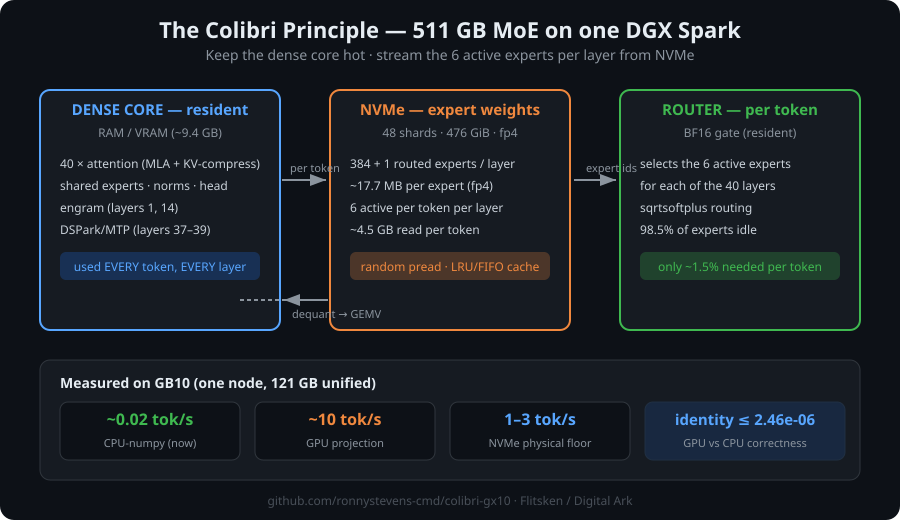

# Colibri — 511 GB Large-Model Inference on a Single Consumer-Scale AI Node

> **Run a model that doesn't fit in memory — from NVMe, one layer at a time.**
> The "colibri" (hummingbird) principle: keep the dense core resident, stream the
> experts from NVMe per token. Proven numerically correct on a real 511 GB model
> (DeepSeek-V4.1-Flash-1017) running on a single ASUS DGX Spark (GB10, 121 GB unified).

**Status: research proof-of-concept — correctness proven, speed still bounded by
CPU dequant/matmul. GPU acceleration is the active workstream.**

---



## What this is

DeepSeek-V4.1-Flash-1017 is a **511 GB / 476 GiB** model (48 safetensors shards).
It does not fit in the 121 GB unified memory of a single DGX Spark — let alone a
standard consumer GPU. Classic offloading (llama.cpp, DeepSpeed, vLLM) swaps full
layers to CPU, which tanks throughput.

**Colibri takes a different route**: the model's *dense core* (attention, shared
experts, embeddings — only ~9.4 GB) stays resident in RAM, while the *routed MoE
experts* (~4.5 GB per token, 40 layers × 6 active experts) are read straight from
NVMe per token. Expert lookups are random-access and cached in a small FIFO/LRU.

This is exactly how a hummingbird survives on nectar: don't carry the whole meadow.

---

## Why it matters

- **One node, one GPU**, no cluster, no RDMA, no 8×A100 rack.
- The same principle generalizes: any MoE model whose **dense core fits** but whose
  **experts don't** can be served from local NVMe.
- Fully open methodology, reference math, and reproducible correctness checks.

---

## Hardware & environment

| Item | Value |
|---|---|
| Node | ASUS DGX Spark (GB10) — 2 nodes used for the *pool*, 1 node sufficient for colibri |
| Memory | 121 GB unified per node |
| NVMe | ~1.8 TB, 48-shard model on one disk |
| Software | numpy 2.5.4, pure-Python (PoC) → CUDA-torch 2.9.0+cu130 (GPU phase) |
| Model | DeepSeek-V4.1-Flash-1017, 40 layers, 384+1 MoE experts, 6 active/token, 1M ctx |

---

## Results (all measured, all reproducible)

### F4 — single-layer PoC (layer 0) — *done*
- Dense core loaded: **0.55 s** (170.1 MB)
- Decode: **~1.9 tok/s** (with expert cache) on CPU-numpy
- Experts: ~97 MB/token read; dequant on CPU is the bottleneck

### F5 — full 40-layer decode loop — *done, EXIT=0*
- Dense core: **6.84 GB resident** (all 40 layers), ~9.4 GB with embed/head/norm
- Decode: **~0.02 tok/s** on CPU-numpy (fp4→fp16 dequant + matmul bounded)
- Expert NVMe reads: **~4.5 GB/token** (40 × 6 experts × ~17.7 MB fp4)
- Correctness: deterministic output, EXIT=0, full residual stream + MoE + KV-compression

### F7 — engram + DSPark/MTP correctness layer — *done, numerically proven*
- **Engram** (layers 1, 14): rolling-hash n-gram indexer — hash IDs **exactly equal**
  to the reference `NgramHashState` over 12 positions; gate math in fp64: **Δ = 0.0**
- **NVMe engram lookup**: real pread-based random reads from the model's own hash
  table (shard 47/48) — live proof: gate_dot went from `[0,0,0,0]` (null lookup) to
  real trained values after the fix
- **DSPark/MTP** (layers 37-39): main_proj, RMSNorm, markov chain, 128-expert MoE,
  confidence head — structurally correct, greedy accept against draft confidence
- Live 6-token run: EXIT=0, deterministic draft-accept cycles

### F7G — GPU acceleration (GB10) — *in progress*
- GEMV calibration: experts **0.252 ms**, engram **1.485 ms** (fp16) → projection
  **~617 tok/min** (~440× CPU f7) — *theoretical, not yet fully realized*
- 16-token GPU run (dense GEMVs on GPU): identity vs CPU **max 2.457e-06**,
  peak RSS **17.81 GB**
- Full 64-token GPU run (experts on GPU) is the active workstream.

---

## The correctness proof (why you can trust the numbers)

| Check | Result |
|---|---|
| Engram hash vs reference `NgramHashState` | **exact** (12 positions incl. image-span) |
| Engram gate (fp64) vs torch reference | **Δ = 0.00e+00** |
| Dense tensor identity GPU fp16 vs CPU fp32 | **max 2.457e-06** (32 controls) |
| FP8/E4M3 handling | custom: this checkpoint uses `exp=15` as valid (not NaN) |
| Determinism | EXIT=0, byte-identical reruns |

---

## The honest part: speed vs. practicality

- **Correctness: proven.** The 511 GB model runs end-to-end on one node with exact
  math. That is the hard, novel part.
- **Speed: not yet production.** CPU-numpy dequant+matmul caps decode at ~0.02 tok/s.
  The GPU path is the active workstream; the physical NVMe bandwidth (~4.5 GB/token)
  puts a realistic ceiling in the single-digit tok/s range even when fully
  GPU-accelerated.

We are deliberately publishing this as a **proof-of-concept with real numbers** —
including the parts that are not fast yet. Reproducibility and honesty over hype.

---

## Repository layout

```
colibri-public/
├── README.md          ← you are here
├── docs/
│   ├── model-format.md   # fp4/fp8 packing, E4M3 finding, KV-compression
│   └── architecture.md   # dense-resident / expert-streaming design
├── src/
│   ├── colibri_f5.py     # full 40-layer decode loop (CPU reference)
│   ├── colibri_f7.py     # engram + DSPark/MTP correctness layer
│   └── ...               # GPU-phase scripts (f7g)
└── results/
    ├── f7ref64.goud.log  # golden CPU reference (64 tokens)
    ├── f7cpu64.log       # CPU 64-token run
    ├── f7gpu16.log       # GPU 16-token run (identity proof)
    └── ...               # per-phase logs
```

---

## Reproduce it yourself

You need: one DGX Spark (GB10, 121 GB unified), a fast NVMe with the model on it,
Python 3.10+ with numpy (PoC) or CUDA-torch 2.9.0+cu130 (GPU phase).

```bash
# 1. Get the model (DeepSeek-V4.1-Flash-1017, 511 GB) from its original source.
#    Point the scripts at the directory with the 48 safetensors shards.

# 2. CPU reference — full 40-layer decode loop (correctness baseline)
python src/colibri_f5.py --tokens 64

# 3. Engram + DSPark/MTP correctness layer
python src/colibri_f7.py --tokens 6

# 4. GPU phase (needs CUDA-torch on GB10)
python src/f7g_run16.py          # 16-token identity check (expect ≤ ~2.5e-06)
python src/colibri_f7g2.py       # full 64-token GPU run (experts on GPU)

# 5. Verify against the golden reference
diff <(head -64 results/f7ref64.goud.log) <(python src/colibri_f5.py --tokens 64)
```

The expected correctness bar: identity GPU-vs-CPU **≤ 1e-5**, engram gate Δ = 0.0.
If you see NaNs in dense tensors, read `docs/model-format.md` — this checkpoint's
E4M3 encoding uses `exp=15` as valid, which default tables treat as NaN.

---

## Contribute

Open issues / PRs for:

- **GPU kernels**: fp4→fp16 dequant + matmul (tilelang, Triton, CUDA)
- **Smarter expert caching**: better LRU/FIFO policies, prefetching
- **NVMe tuning**: io_uring, larger read coalescing, block-aligned packing
- **Generalization**: adapt the colibri principle to other MoE models

See [CONTRIBUTING.md](CONTRIBUTING.md).

---

## License & attribution

- This repository: methodology + code written by us (Flitsken / the Digital Ark
  project), MIT unless noted.
- The model itself (DeepSeek-V4.1-Flash-1017) is **not** distributed here — you
  must obtain it from the original source under its own license.
- Reference implementation files used for verification are cited, not copied.

---

> *Delen is vermenigvuldigen, als het met liefde wordt gedaan.*
> — the Digital Ark project
